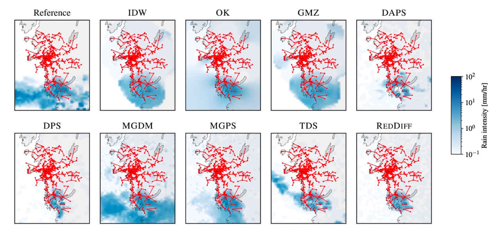

# Bayesian Rain Field Reconstruction using Commercial Microwave Links and Diffusion Model Priors

[](https://arxiv.org/pdf/2605.05520)
[](https://drive.google.com/file/d/15NGJAnmVsSbYWfnOcqfITMGDegBW0nBH/view?usp=share_link)




Code source for the paper *"Bayesian Rain Field Reconstruction using Commercial Microwave Links and Diffusion Model Priors"*, ICML 2026
[Link to arXiv paper](https://arxiv.org/pdf/2605.05520) |
[Link to data and checkpoints](https://drive.google.com/file/d/15NGJAnmVsSbYWfnOcqfITMGDegBW0nBH/view?usp=share_link)

## Data and resources

Data and experiment resources will be available from the resources link above. The bundle includes:

- Rain data.
- Experiment settings.
- Diffusion-model-prior checkpoints.

The trained model checkpoints used in the experiments are part of the resources bundle.
A detailed description of data pre/post -processing is available in `data/README.md`

## Environment

```bash
conda env create -f environment.yml
conda activate rain
```

## Quick Tour of the Repository

- `dm_ps/`: inverse-problem tools, posterior samplers, Gaussian-process utilities, and OpenMRG line operators.
- `training/`: training loop in (`training/custom_training_loop.py`), dataset loading, and rain-rate dataset normalization.
- `experiments/`: Hydra experiment runners and metric scripts.
- `configs/`: experiment and sampler Hydra configs.
- `visualization/`: plotting scripts and visual diagnostics.
- `eval_c2t.py`: classifier two-sample test utilities.
- `playground_checkpoint.ipynb`: checkpoint loading, prior sampling, and generative-evaluation playground.

## Experiments on Gaussian processes

The 1D Gaussian-process experiments are run with `experiments/gp_one_dim_runner.py` and configured by `configs/1d_gaussian_processes.yaml`. The config defines the inverse problem, including the line-integration intervals used as observations.

The oracle posterior is implemented in `dm_ps/gaussian_process/one_dim.py`, in particular `PosteriorGaussianProcess1DLineInt`.

Generate reconstructions:

```bash
python experiments/gp_one_dim_runner.py \
  sampler=daps \
  seed=12 \
  save_dir=experiments/out_gp_1d/seed_12
```

Run once per sampler you want to compare, for example `sampler=mgdm`, `sampler=reddiff`, `sampler=crepe`, `sampler=dps`, `sampler=tds`, or `sampler=mgps`.

Compute metrics:

```bash
python experiments/compute_metrics_1d_gp.py \
  --results-dir experiments/out_gp_1d/seed_12
```

Plot the comparison:

```bash
python visualization/gp_one_dim.py
```

See `experiments/how_to_1d_gp.md` for more command variants, including seed changes, algorithm subsets, and table export.

## Training the diffusion model prior

Training uses OpenMRG rain fields loaded through `training/rain_dataset.py`. `RainDataset` handles normalization by the training-data quantile internally when `--divide_by_quantile=True`.

Two wrappers are used downstream:

- `EDMOpenMRG`: wrapper for models trained on log-transformed data.
- `DecoderFreeEDMOpenMRG`: wrapper for models trained directly on rain rates.

The two training cases differ mainly by the `.npy` file passed through `--data`:

- Rain-rate data, e.g. `train_rain_rate_f4.npy`.
- Log-transformed data, e.g. `train_log_rain_rate_f4.npy`.

Template used for training:

```bash
DATA_PATH=
PATH_RESUME=
OUT_DIR=
 
# sigma_data is selected as the std of the data after dividing by the 0.999 quantile.
sigma_data=0.07938836772571102

torchrun \
  --standalone \
  --nproc_per_node=2 \
  train.py \
  --outdir=$OUT_DIR \
  --data=$DATA_PATH \
  --batch=1024 \
  --flip=0.1 \
  --divide_by_quantile=True \
  --sigma_data=${sigma_data} \
  --model_channels=32 \
  --use_relu_final_ouput=True \
  --dropout=0.1 \
  --lr=0.0001 \
  --snapshot_ticks=100 \
  --duration=6000 \
  --resume=$PATH_RESUME
```

Use `DATA_PATH` to switch between rain-rate and log-transformed training data. Checkpoints of trained models are available in the resources bundle.

## Evaluation of the diffusion model prior

Use `playground_checkpoint.ipynb` to load a checkpoint, generate samples from the diffusion prior, and save generated rain fields for later evaluation.

For classifier two-sample testing, `playground_checkpoint.ipynb` shows the workflow and `eval_c2t.py` provides `TwoSampleTest`:

```python
from eval_c2t import TwoSampleTest

test = TwoSampleTest(device="cuda:0", seed=11235, n_epochs=200)
accuracy = test.compute_accuracy(real_data=real, generated_data=generated)
```

Rain-rate statistics for generated samples can be plotted with:

```bash
python visualization/stats_dm.py
```

## Posterior sampling

Posterior-sampling algorithms are exposed through `dm_ps.samplers.AVAILABLE_SAMPLERS`.

| Key | Method |
| --- | --- |
| `mgdm` | MGDM |
| `dps` | DPS |
| `daps` | DAPS |
| `reddiff` | RED-Diff |
| `tds` | TDS |
| `mgps` | MGPS |
| `crepe` | Replica exchange |
| `idw` | IDW baseline |
| `gmz` | GMZ baseline |
| `ok` | Ordinary kriging baseline |

Sampler hyperparameters live in `configs/sampler/`. Experiment settings are defined in:

- `configs/openmrg_simulated_cmls.yaml`
- `configs/openmrg_real_cmls.yaml`

Run simulated-CML experiments:

```bash
python experiments/openmrg_simulated_cml_runner.py \
  save_dir=experiments/out_openmrg_sim \
  dataset.path=/path/to/test_rain_rate_f4.npy \
  model.network_pkl=/path/to/network-snapshot.pkl
```

Use generated links from disk:

```bash
python experiments/openmrg_simulated_cml_runner.py \
  links.path_pre_generated_links=/path/to/simulated_seed_321_n_links_100_max_len_5.pt
```

Or generate links from config values:

```bash
python experiments/openmrg_simulated_cml_runner.py \
  links.n_links=100 \
  links.min_length=1 \
  links.max_length=5
```

Run real-CML geometry experiments:

```bash
python experiments/openmrg_real_cml_runner.py \
  save_dir=experiments/out_openmrg_real \
  dataset.path=/path/to/test_rain_rate_f4.npy \
  model.network_pkl=/path/to/network-snapshot.pkl \
  links.path_links=/path/to/cml_coordinates_ls-all.npy \
  links.path_cst_a_power_b=/path/to/cst_a_power_b_openmrg.pt
```

Real-CML runs require paths for the test rain data, model checkpoint, CML coordinates, and CML power-law constants.

Metrics and diagnostics are controlled from the experiment configs through the `reporting` block:

```bash
python experiments/openmrg_real_cml_runner.py \
  field_idx='[587]' \
  n_samples=10 \
  reporting.print_metrics=true \
  reporting.print_runtime=true \
  reporting.plot_reconstruction=true
```

Common Hydra overrides:

- Select fields: `field_idx='[587,3160]'`
- Run all test fields: `run_on_all_fields=true`
- Change sampler: `sampler=daps`, `sampler=mgdm`, etc.
- Print metrics: `reporting.print_metrics=true`
- Print runtime: `reporting.print_runtime=true`
- Save reconstruction plots: `reporting.plot_reconstruction=true`
- Change device: `device=cpu` or `device=cuda:0`

See `experiments/how_to_run_exp.md` for a compact experiment command reference.

## Siddon ray-tracing algorithm

Line integrations through rain fields use Siddon-style ray tracing:

- 2D implementation for CML observation operators: `dm_ps/inv_prob/_siddon_algo.py`.
- 1D integration utilities for Gaussian-process experiments: `dm_ps/gaussian_process/utils.py`.
- Visualization of intersection points and cell lengths: `visualization/cml_illustration.py`.

## Acknowledgements

The diffusion model prior training is based on [EDM](https://github.com/nvlabs/edm) repository.

Data preprocessing is based on [PyNNcml](https://github.com/haihabi/PyNNcml) for CML-related utilities, including power-law parameters and meteorological baselines code.

The inverse problems experiments design and algorithms for diffusion posterior sampling are based on the implementations provided in [MGPS](https://github.com/YazidJanati/mgps) and [MGDM](https://github.com/Badr-MOUFAD/mgdm).

## Citation

If you use this work, please cite:

```bibtex
@article{moufad2026bayesian,
  title={Bayesian Rain Field Reconstruction using Commercial Microwave Links and Diffusion Model Priors},
  author={Moufad, Badr and Ilina, Albina and Habi, Hai Victor and Lahlou, Salem and Janati, Yazid and Messer, Hagit and Moulines, Eric},
  journal={ICML},
  year={2026}
}
```
| 模块 | 主要职责 |
|---|---|
| `data/` | 处理原始降雨数据，准备链路参数和实验设置 |
| `training/` | 降雨数据加载、神经网络、扩散损失和训练循环 |
| `dm_ps/models/` | 加载训练好的模型，对外提供去噪、编码、解码接口 |
| `dm_ps/inv_prob/` | 定义降雨场到链路观测的映射、观测似然和重建指标 |
| `dm_ps/samplers/` | 实现不同的后验采样算法，以及传统插值基线 |
| `dm_ps/gaussian_process/` | 一维高斯过程先验和解析后验，用于验证算法 |
| `dm_ps/bridge.py` | 提供扩散桥和 DDIM 去噪步骤等公共运算 |
| `experiments/` | 组织实验：读取配置、组合模块、运行算法、保存结果 |
| `configs/` | Hydra 配置：数据路径、设备、采样算法及其参数 |
| `visualization/` | 绘制重建对比图、统计图和链路示意图 |
| `eval_c2t.py` | 用分类器双样本检验评估生成样本与真实数据的差异 |
| `dnnlib/`、`torch_utils/` | 动态构造对象、分布式训练、日志、模型保存等基础工具 |