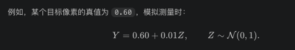

# PPData5D 跨频段数据（固定 30 m）

原始路径默认为 `/home/czh/PPData5D-success`，按需读取文件，不生成大型 NPY，不修改原始数据。

## 配对与高度

真实文件名示例：`png/06.DenseUrban/T06C1D0123_n02_f03_ss_z01.png`。
只索引 `z01`，以 `T06C1D0123_n02` 配对源/目标频段以及
`npz/T06C1D0123_n02_bdtr.npz`。NPZ 使用 `inBldg_zyx[1]` 和
`terrain_yx`。高度轴在读取后移除，目标张量为 `[1,H,W]`。

频段通过 `f00`—`f04` 编号选择；**示例默认 `f00 → f03`**，不代表已确认其他编号的 GHz 数值。
缺少任一所选频段或 NPZ 的样本会跳过并报告。不会用其他高度、其他发射机或其他地图补齐。
两条路径都使用完整配对集，即使基准路径不使用源条件。

按完整地图 ID（`TxxCxDxxxx`，包含该地图所有 `nXX`）划分 train/val/test，
默认约 80%/10%/10%，种子 42。先划分地图，再筛选完整配对，因此改变频段不会重新分配地图。
建议保存并复用同一份 manifest；数据目录新增/移除地图后，重新扫描可能改变划分。

## 生成索引

在项目根目录、已安装项目依赖的环境中执行：

```bash
python data/prepare_radio.py \
  --data /home/czh/PPData5D-success \
  --source-frequency f00 --target-frequency f03 \
  --output data/ppdata5d_z01.json
```

索引记录配对路径、地图/发射机编号、集合和缺失计数。可通过 `--seed`、
`--val-fraction`、`--test-fraction` 调整划分。传入 manifest 时，必须指定相同频段；
`--data` 指定读取根目录，因此数据迁移后仍可复用相对路径。

## 数据字段和归一化
转成张量并构造条件，设批量大小为 B，当前地图大小为 128×128：
| 数据 | 张量形状 | 处理方式 |
|---|---|---|
| 目标地图 `target` | `[B,1,128,128]` | PNG 灰度除以 255 |
| 建筑图 | `[B,1,128,128]` | 30 m 层的建筑占用，0/1 |
| 地形图 | `[B,1,128,128]` | 默认除以 1000 |
| 有效区域掩码 | `[B,1,128,128]` | 默认建筑外为 1 |
| 源频段观测 | `[B,1,128,128]` | 归一化源地图，未观测位置填 0 |
| 源观测掩码 | `[B,1,128,128]` | 标明哪些源像素有观测 |


```python
from training.radio_dataset import RadioDataset

dataset = RadioDataset(
    path='/home/czh/PPData5D-success',
    manifest='data/ppdata5d_z01.json',
    split='test',                 # train / val / test / all
    source_frequency='f00', target_frequency='f03',
    use_source=True, source_fraction=0.5, target_fraction=0.01,
)
sample = dataset[0]
```

| 字段 | 含义 |
| --- | --- |
| `target` | 完整目标频段，训练真值或离线评估真值 |
| `condition` | 基准：建筑、地形、有效掩码；跨频段：再加源观测、源掩码 |
| `valid_mask` | 默认排除 30 m 建筑内部；可用 `exclude_buildings=False` 保留 |
| `source_observations`, `source_mask` | 源频段观测及其位置；缺测填 0，通过掩码区别真实 0 |
| `target_observations`, `target_mask` | 目标频段点观测及位置，供后续目标似然使用 |
| `evaluation_mask` | 有效且未被目标观测覆盖的像素，供 MAE/RMSE 等评估使用 |
| `building`, `terrain` | 建筑占用和缩放后的地形 |
| `sample_id`, `map_id`, `transmitter_id` | 配对和实验追踪元数据，具体地图和发射机编号会记录在输出的 sample_id 中。 |

所有空间字段形状为 `[1,H,W]`，`condition` 为 `[3,H,W]` 或 `[5,H,W]`；
DataLoader 增加 batch 轴。数据不包含高度轴，也不把全部频段拼成扩散输出。

PNG 必须是 8 位单通道，统一除以 255 到 `[0,1]`，逆变换乘 255。
不使用雨场分位数、对数变换，也不做逐图 min-max。尚无灰度到 RSS/路径损耗的标定，
所以不能把这些数值或其误差直接标作 dB/dBm。地形使用固定比例 `terrain / terrain_scale`，
默认 `terrain_scale=1000`；可按数据单位调整，同一实验训练与推理必须一致。
这些变换不从测试地图拟合任何统计量。

点观测从有效区域无放回抽取，数量为 `round(有效像素数 × fraction)`，允许零个观测。
目标掩码按种子和样本 ID 固定，不随源观测密度或 `use_source` 改变。
训练时源掩码随机采样，源观测由 source_fraction 控制。例如 0.5 表示随机保留约一半有效像素；同时提供掩码，避免把缺测的填充值误认为真实信号。；验证/测试时固定。训练翻转同步应用于所有地图和掩码；
验证/测试不翻转。返回的目标观测无附加噪声，如需噪声应在后续观测模型中显式添加。

## 接入训练

```text
基准路径：

[加噪目标图 | 建筑图 | 地形图 | 有效掩码]
               ↓
        U-Net 输入 4 通道
               ↓
        输出目标图 1 通道


跨频段路径：

[加噪目标图 | 建筑图 | 地形图 | 有效掩码 | 源观测 | 源掩码]
               ↓
        U-Net 输入 6 通道
               ↓
        输出目标图 1 通道
```
代码中由 [EDMPrecond (line 632)](/home/czh/rainfield-diffusion-models/training/networks.py:632) 完成拼接：目标噪声图先经过 EDM 的尺度处理，再与条件拼接。条件本身不加扩散噪声，噪声强度 sigma 通过网络的噪声嵌入输入。

模型恢复的答案始终是完整的 f03 地图（即目标频段）。损失比较预测目标图与真实目标图，默认只在建筑外的有效像素上计算。

`train.py` 自动将目录识别为 PPData5D，也可显式指定 `--dataset=radio`。
空间条件模型目前使用 EDM。`--cond` 仍指类别标签，请保持 `False`。

先检查数据与配置（无需 GPU）：

```bash
python train.py --data /home/czh/PPData5D-success \
  --radio-manifest data/ppdata5d_z01.json --dry-run
```

训练基准路径：

```bash
python train.py --dataset radio --data /home/czh/PPData5D-success \
  --radio-manifest data/ppdata5d_z01.json \
  --outdir out_radio_baseline --use-source=False \
  --source-frequency=f00 --target-frequency=f03 \
  --batch=8 --model_channels=32 --sigma_data=0.12 --seed=42
```

训练跨频段路径：

```bash
python train.py --dataset radio --data /home/czh/PPData5D-success \
  --radio-manifest data/ppdata5d_z01.json \
  --outdir out_radio_source --use-source=True --source-fraction=1.0 \
  --source-frequency=f00 --target-frequency=f03 \
  --batch=8 --model_channels=32 --sigma_data=0.12 --seed=42
```

`sigma_data=0.5` 是起始配置，并非此数据集实测标准差；可仅用训练集估计后调整。
每个模型对应一组固定频段，因此频率编号保存在配置中，不额外广播成空间通道。
训练只对 `target` 加噪和去噪，条件不加噪；损失按每张图有效像素平均。
目标稀疏观测不进入先验条件或训练损失。无线电模型关闭雨场默认的输出 ReLU。
原有 `.npy` 雨场入口保持可用。

加载训练后的网络，显式传入相同定义的空间条件：

```python
# x_t: [B,1,H,W]，sigma: [B]，condition: [B,3或5,H,W]
denoised_target = net(x_t, sigma, condition=condition)
```


无线电后验重建已接入点观测算子与条件网络，见下节。
原 OpenMRG CML 实验入口仍对应雨场线积分。
源观测只属于先验条件，不合入目标观测似然。
NPZ 未提供发射机坐标，`nXX` 仅是采样编号；当前不伪造发射机位置通道。

## 训练完成后的输出文件
两条训练命令（加入源频段训练与基准训练）会分别训练跨频段模型和基准模型，各自保存权重。训练过程中会保存多个阶段的快照，因此不一定只有两个文件。
输出位置由 --outdir 决定。首次运行、单 GPU 时，目录结构如下：
```bash
/home/czh/rainfield-diffusion-models/
├── out_radio_source/
│   └── 00000-ppdata5d-z01-f00-f03-source-ddpmpp-edm-gpus1-batch8-fp32/
│       ├── network-snapshot-XXXXXX.pkl
│       ├── training-state-XXXXXX.pt
│       ├── training_options.json
│       └── log.txt
└── out_radio_baseline/
    └── 00000-ppdata5d-z01-f00-f03-baseline-ddpmpp-edm-gpus1-batch8-fp32/
        ├── network-snapshot-XXXXXX.pkl
        ├── training-state-XXXXXX.pt
        ├── training_options.json
        └── log.txt
```
其中：
- network-snapshot-XXXXXX.pkl：推理重建时加载的模型权重。
- training-state-XXXXXX.pt：包含网络和优化器状态，用于恢复训练。
- XXXXXX：累计训练样本数，以**千张**为单位。
- 00000：本次运行编号，后续重新启动训练通常生成 00001 等新目录。

## 目标点观测引导的后验重建

`dm_ps/inv_prob/create_inv_prob_radio.py` 实现：
无线电重建现在使用：
[点观测模型](/home/czh/rainfield-diffusion-models/dm_ps/inv_prob/create_inv_prob_radio.py)：支持像素采样、双线性插值及逐点高斯噪声。
[DPS 采样器](/home/czh/rainfield-diffusion-models/dm_ps/samplers/dps_ve.py)：通过观测似然和去噪网络，将梯度反传到扩散状态。
[无线电重建入口](/home/czh/rainfield-diffusion-models/experiments/radio_point_runner.py)：基准与跨频段路径共用同一组目标观测、算子和随机噪声，源频段仅作为先验条件。

\[
Y_{t,i}=H_{t,i}(X_t)+\epsilon_i=X_t(r_i)+\epsilon_i,\qquad
\log p(Y_t\mid X_t)=-\frac12\sum_i\frac{(Y_{t,i}-H_{t,i}(X_t))^2}{\sigma_i^2}+\mathrm{const}.
\]

坐标采用像素单位 `(x,y)=(列,行)`，左上角像素中心为 `(0,0)`；
整数坐标直接读取像素，非整数坐标按四邻像素双线性插值。越界位置会报错。

**注：**这里的双线性插值只用于从一张候选地图中读取测量位置的预测值，没有用它生成整张无线电地图。前面的解释没有把这两件事区分清楚。
| 方法 | 输入 → 输出 |
|---|---|
| 用插值重建地图 | 少量实际观测值 → 插值得到整张地图 |
| 当前扩散重建 | 扩散模型生成候选地图 → 在测量位置取值 → 与实际观测比较 → 用梯度修正生成过程 |

例如，扩散模型已经预测了一张 128×128 地图，但接收机恰好位于 (10.5,20.5)，地图没有这个下标。此时才用周围四个模型预测值，估算该位置的预测观测，供似然计算。

没有 RSS 沿链路积分、雨强幂律系数，也不将负观测截断为 0。
若提供有效区域掩码，观测的所有非零插值权重必须落在有效像素上。

`dm_ps/samplers/dps_ve.py` 在 `guidance='likelihood'` 时，计算
`inverse_problem.log_pot(model.decode(model.denoiser_fn(z, sigma)))` 对 `z` 的梯度，
梯度穿过点采样算子和去噪网络。`EDMRadio` 绑定当前场景的条件，输出保持 `PNG/255` 单位，
不经过雨场的分位数还原、指数变换或阈值截断。

训练好两条路径的模型后，执行：

```bash
python experiments/radio_point_runner.py \
  --data /home/czh/PPData5D-success \
  --manifest data/ppdata5d_z01.json \
  --baseline-checkpoint /path/to/baseline/network-snapshot-XXXXXX.pkl \
  --source-checkpoint /path/to/source/network-snapshot-XXXXXX.pkl \
  --source-frequency f00 --target-frequency f03 \
  --source-fraction 0.5 --target-fraction 0.01 \
  --obs-std 0.01 --field-index 0 --n-samples 4 --n-steps 50 \
  --gamma 0.1 --seed 42 --device cuda:0 \
  --save-dir out_radio_points
```

因为 `--split` 默认是 test。如果想运行验证集时，增加 `--split val`，如下：
```bash
python experiments/radio_point_runner.py \
  --data /home/czh/PPData5D-success \
  --manifest data/ppdata5d_z01.json \
  --baseline-checkpoint /path/to/baseline/network-snapshot-XXXXXX.pkl \
  --source-checkpoint /path/to/source/network-snapshot-XXXXXX.pkl \
  --source-frequency f00 --target-frequency f03 \
  --source-fraction 0.5 --target-fraction 0.01 \
  --split val \
  --obs-std 0.01 --field-index 0 --n-samples 4 --n-steps 50 \
  --gamma 0.1 --seed 42 --device cuda:0 \
  --save-dir out_radio_val_gamma_0.1
  调整 gamma 时，在多个验证样本上尝试不同取值，保持观测、随机种子和其他配置相同，比较未观测有效区域的 MAE/RMSE。不同实验使用不同输出目录，避免覆盖结果。
确定 gamma 后，再使用 --split test 运行最终测试，不根据测试集误差继续调参。
  ```
1、`--source-fraction 0.5 --target-fraction 0.01` 表示：源频段：随机保留约 50% 的有效像素值（有效像素指建筑外的像素），作为跨频段模型的条件输入。目标频段：保留约 1% 的有效像素值，通过观测似然引导重建。

也可只传一个 checkpoint 运行单条路径。需要前述无线电条件训练生成的模型，
原雨场 checkpoint 的输出单位、图像尺寸和条件通道不匹配。
入口会核对 checkpoint 中的频段、地形缩放、建筑排除策略和路径类型。
2、`--source-fraction` 建议与训练时的部署观测假设一致；可显式改变用于密度消融。
**为什么 “建议source-fraction与训练时的部署观测假设一致“？**
| 训练时 | 推理时 | 含义 |
|---|---|---|
| 源观测 50% | 源观测 50% | 观测密度一致，但位置可以不同 |
| 完整源地图 | 源观测 10% | 推理时缺失的信息远多于训练时，效果可能下降 |
| 完整源地图 | 完整源地图 | 适合部署时确实拥有完整源地图的情况 |

**“改变用于密度消融”是什么意思？**
就是分别提供 10%、25%、50%、100% 的源观测，保持目标观测和其他条件一致，研究“源频段观测越多，重建是否越好”。

3、`--obs-std` 测量噪声，由 obs-std 控制，加在选中的目标频段观测值上

4、`--field-index` 是所选集合中的样本下标，默认使用 test 集。这里 --field-index 0 选的是测试集中的第一个样本，仅重建这一个样本地图，并非运行整个测试集。
5、`--split-seed` 控制划分/掩码，`--seed` 控制观测噪声与采样噪声。
6、`--n-samples 4`，扩散模型会生成 4 张候选重建图。两条路径都运行时，各生成 4 张，统一保存在这个场景对应的一个 .pt 文件中。

7、不提供外部观测文件时，从 `target_mask` 位置读取真值并添加一次高斯噪声，作为模拟实验。
两条路径复用同一个逆问题对象，包括 `H_t`、`Y_t`、`sigma_i`；
初始噪声和每步随机噪声也相同，只改变条件先验。目标真值只用于生成模拟观测与计算指标。

8、已有实际目标观测时，增加 `--observations measurements.npz`。文件格式：

```python
import numpy as np

np.savez('measurements.npz',
         positions=np.array([[10.0, 20.0], [35.25, 40.5]], dtype=np.float32),
         values=np.array([0.80, 0.60], dtype=np.float32),
         obs_std=np.array([0.01, 0.02], dtype=np.float32))
```

`positions` 为 `[N,2]`，`values` 为 `[N]`；可选 `obs_std` 为标量或 `[N]`，
优先于命令行 `--obs-std`。实测值原样使用，不从目标真值重新生成，也不再次添加噪声，（**因为这些数值在测量过程中已经受到设备误差、环境波动等影响，所以直接把它们作为观测 \(Y_t\)，不再人为加一次噪声**。）
坐标必须与当前样本地图对齐，观测值和噪声标准差必须与地图处于同一归一化单位。
仅有未标定 PNG 时，不能将 dBm 测量直接作为这些灰度值的观测。
该命令行入口用于数据集场景的重建评估，仍会加载目标真值用于指标；
底层 `create_inv_prob` 支持仅传尺寸、位置和实测值，无需目标真值。

9、重建结束后，会自动在 `--save-dir` 下的 `comparisons/` 文件夹保存对比图，无需增加参数。例如：

```text
out_radio_points/
├── <sample_id>.pt
└── comparisons/
    ├── <sample_id>_baseline_comparison.png
    └── <sample_id>_source_comparison.png
```

只运行一条路径时，只生成该路径的图片。每张图从左到右为：

- **Generated**：该路径的多次重建均值，例如 `--n-samples 4` 时取 4 张候选地图的平均。
- **Ground Truth**：对应目标频段的真实地图。
- **Absolute Difference**：重建均值与真值的逐像素绝对误差。

地图统一使用 `viridis` 和 `[0,1]` 色标，误差使用 `Reds`，两条路径共享误差色标上限。
色条两端的三角形表示超出地图显示范围的值；显示范围不会截断 `.pt` 中的原始数值或改变指标。
所有数值单位均为 `PNG/255`。无效区域（默认建筑内）显示为灰色。
误差图覆盖全部有效像素；图标题中的 MAE/RMSE 仅在未参与观测的有效像素上计算，与 `.pt` 中的指标一致。
该功能在运行 `experiments/radio_point_runner.py` 后生成图片，训练命令本身不生成这些对比图。
默认的 `out_radio_points/` 已被 `.gitignore` 忽略。

每个样本保存一个 `.pt`，包含观测、位置、标准差、条件、有效区域掩码、随机种子、采样配置，
以及各路径的多张重建图、均值、样本方差和 MAE/RMSE。（这里的“**一个样本”指同一张区域地图、同一个发射机编号、固定源/目标频段和 30 m 高度组成的一次重建任务，--field-index 0 就是选择数据集合中的第一个这样的样本**“。）
| 保存内容 | 用途 |
|---|---|
| 观测值、位置 | 记录这次重建究竟已知哪些位置、哪些数值 |
| 观测标准差 | 记录似然中如何描述测量误差 |
| 条件 | 记录模型实际收到的建筑、地形、源观测及掩码 |
| 随机种子 | 记录随机过程的起点，便于在相同环境和配置下重复实验 |
| 采样配置 | 记录采样步数、引导强度等，便于解释结果差异 |
| 重建图、均值、方差、误差 | 用于展示重建、分析不确定性和评估效果 |

MAE/RMSE 在有效且未观测区域上评估后验均值；非整数观测保守地排除所有非零权重的邻接像素。
`observation_rmse` 单独衡量均值与带噪观测的一致性。所有指标单位为归一化灰度，输出不裁剪。

`gamma` 是似然梯度步长，需要在验证集调整；以上只是起始配置。
默认逐样本归一化梯度，避免低噪声下数值过大；这会消除统一标准差对梯度整体幅度的影响，
逐点不同标准差仍影响方向。`--no-normalize-grad` 保留完整高斯梯度幅度，此时通常需要更小的 `gamma`。
标准差必须大于 0；无噪声模拟的严格等式约束不是这个高斯似然接口的功能。
DPS 属于近似后验引导，重建质量和不确定性仍需要训练模型与评估验证。
原雨场/GP DPS YAML 显式使用 `guidance: residual` 保持既有残差范数设置；
无线电入口固定使用 `guidance='likelihood'`。

## 验证与环境

```bash
python -m unittest discover -s tests -v
```

测试覆盖高度过滤、配对缺失、地图级划分、源/目标掩码隔离、同步翻转、
有效区域损失、条件网络前向/反向传播、点采样/插值、解析梯度与数值梯度一致性、
高斯噪声权重、DPS 梯度反传及两条路径共用观测和随机噪声。
项目固定的 PyTorch 1.12.1 需要 NumPy 1.x；`environment.yml` 已限制 `numpy<2` 和 `basemap<2`。
仅修改环境文件不会自动修复已创建的 Conda 环境。如果遇到 `_ARRAY_API not found`、
`Numpy is not available`，并且 NumPy 版本为 2.x，可以运行：

```bash
conda activate rain
conda install --name rain 'conda-forge::numpy=1.26.4' 'conda-forge::basemap=1.4.1' 'conda-forge::basemap-data=1.3.2' 'packaging<24'
python -c "import numpy as np, torch; print(np.__version__, torch.__version__); print(torch.from_numpy(np.zeros(1, dtype=np.float32)))"
python train.py --data /home/czh/PPData5D-success --radio-manifest data/ppdata5d_z01.json --dry-run
```

Basemap 2.0 的 Python 依赖声明要求 NumPy 2，需要同时调整到兼容版本。
Basemap 1.4.1 还需要 `basemap-data<1.4` 和 `packaging<24`，因此一并约束。
数据索引生成成功并不代表 PyTorch 与 NumPy 的张量转换正常，以上检查会实际调用 `torch.from_numpy`。
`Skipped incomplete z01 samples` 是缺失频段的配对统计，不是本次环境错误。
正式训练沿用原项目 CUDA 训练循环。


## 注：运行产物
### 1:
```bash
python data/prepare_radio.py \
  --data /home/czh/PPData5D-success \
  --source-frequency f00 --target-frequency f03 \
  --output data/ppdata5d_z01.json
索引生成成功。此次仅使用 30 m（z01） 数据，配对 f00 → f03：
- 共发现 7,636 个地图与发射机组合。
- 5,458 个具备两个所选频段及环境数据。
- 2,178 个因缺少源频段或目标频段被跳过。
- 完整配对中没有缺少环境数据的样本。
- 划分为训练集 4,412、验证集 522、测试集 524。
```


### 2、日志字段含义：

| 字段             | 含义                                                        |
| ---------------- | ----------------------------------------------------------- |
| `tick 57`        | 当前代码中的训练更新计数，下标从 0 开始；不是第 57 个 epoch |
| `kimg 0.5`       | 累计处理约 0.5 **千张**训练样本，即约 500 张，包含重复抽取      |
| `time 12s`       | 从训练循环启动至今约 12 秒                                  |
| `sec/tick 0.2`   | 最近一次训练更新耗时约 0.2 秒                               |
| `sec/kimg 19.03` | 按当前速度，处理 1,000 张样本约需 19 秒                     |
| `Loss 3.2`       | 当前批次的扩散训练损失                                      |
| `cpumem 4.27`    | 当前训练进程占用约 4.27 GiB 内存                            |
| `gpumem 3.56`    | 本次统计区间内，张量占用显存的峰值约 3.56 GiB               |
| `reserved 4.04`  | PyTorch 显存分配器预留的峰值约 4.04 GiB，包含缓存空间       |
